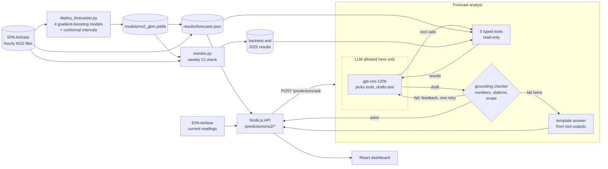

# AURA-GUARD: NO₂ forecasts you can check

> Built for the **NASA Space Apps Challenge 2025**, Problem Statement 9: Air Quality Forecasting.

[](https://github.com/CODER7657/AURA-GUARD/actions/workflows/ml-tests.yml)
[](https://github.com/CODER7657/AURA-GUARD/actions/workflows/ml-monitor.yml)
[](https://colab.research.google.com/github/CODER7657/AURA-GUARD/blob/master/ml/notebooks/backtest_colab.ipynb)
[](LICENSE)

Hour-to-day-ahead NO₂ forecasts at 20 US air quality monitors, with 90% intervals,
and a question-answering agent that is not allowed to say a number it cannot trace
to the forecasts. It is for people who need a short-range NO₂ outlook at a specific
monitor (air quality staff, researchers, app builders) and for anyone who wants to
see how each claim was measured.

**Measured result:** trained on 2024 only and scored on all of 2025, the 12-hour
forecast's mean absolute error is **3.82 ppb, 33% lower than persistence** ("the next
reading equals this one"), over about 162,000 forecasts.

### Quick start

```bash
git clone https://github.com/CODER7657/AURA-GUARD.git && cd AURA-GUARD/ml
pip install -e ".[dev]"
pytest                                   # offline, seconds: no data, key or network
cp .env.example .env                     # add a Groq API key to ask the agent
python -m auraguard.agent "Will NO2 be high near Chicago tomorrow morning?"
```

The served forecasts are in [`ml/results/forecasts.json`](ml/results/forecasts.json).
Method, every number and the limitations: [`ml/README.md`](ml/README.md).

## What is real, and what is not yet

| Part | Status |
|---|---|
| NO₂ forecaster ([`ml/`](ml/README.md)) | **Real.** Gradient boosting trained on EPA AirData hourly NO₂ from 20 monitors, 2024; walk-forward backtest, then checked on all of 2025 |
| NO₂ forecasts in the API and dashboard | **Real model output, not live.** Issued from the last hour of the newest EPA file (March or April 2026), 17 of 20 stations; every response says when |
| Forecast analyst (`POST /api/v1/predictions/ask`, CLI) | **Real.** An LLM limited to five forecast tools, with a deterministic grounding check on every answer |
| Weekly monitoring | **Real.** A GitHub Actions job re-scores the model on the newest public EPA data and fails below fixed thresholds |
| Current readings | **Real when configured.** EPA AirNow, with an AirNow API key |
| AQI / PM2.5 forecasts in `/predictions/realtime` and `/forecast` | **Simulated.** Current reading plus random variation; responses say so in `aqi_forecast_simulated` |
| NASA TEMPO satellite data | **Not integrated yet.** It needs a NASA Earthdata account |

An earlier version of this README reported "86.98% accuracy" and "1.7 ms inference"
for an LSTM. Those numbers were written into the code, and the model only ever saw
randomly generated data. They have been removed everywhere.

## Forecasting results

Hourly NO₂ forecasts 1, 6, 12 and 24 hours ahead. The backtest scores each month from
July to December 2024 with a model trained only on earlier data. The 2025 check scores
the deployed model, trained on 2024, on a year it never saw.

| Horizon | Persistence, backtest | Gradient boosting, backtest | Improvement | Gradient boosting, 2025 | Improvement, 2025 | 90% interval coverage, 2025 |
|---|---|---|---|---|---|---|
| 1 h | 2.00 ppb | **1.85 ppb** | 7% | 1.71 ppb | 8% | 92.8% |
| 6 h | 5.30 ppb | **3.69 ppb** | 30% | 3.44 ppb | 30% | 93.9% |
| 12 h | 6.11 ppb | **4.11 ppb** | 33% | 3.82 ppb | 33% | 94.2% |
| 24 h | 4.88 ppb | **4.32 ppb** | 11% | 4.01 ppb | 15% | 94.0% |

Mean absolute error, lower is better. Persistence alone scores **R² 0.90** one hour
ahead, which is why every model here is judged by how much it beats persistence
rather than by R². Interval coverage is pooled; at the busiest station it is only
about 80%, because the interval width is shared by all stations.


## The forecast analyst

Ask it "Will NO₂ be high near station X tomorrow morning?" or "How sure are you?".
The LLM (`openai/gpt-oss-120b` on Groq) chooses tools and writes the answer; it never
sees the model, the data or the network. A deterministic checker then requires every
number to come from a tool output, every station and state to exist, and an honest
refusal for other pollutants, places without a monitor and medical questions. A failed
answer gets one retry with the checker's feedback, then falls back to a template built
only from tool outputs.

**Agent eval, partial: 19 of 40 questions run.** The 40 questions were committed
before the agent code (`af66b22`). Groq's free tier allows 200,000 tokens a day, and the
19 questions already used it, so the run stopped there. Only the answerable (14 of 14)
and the first 5 of 8 ambiguous questions have been asked. **The wrong-premise (8) and
out-of-scope (10) questions, which are the ones that test refusals, have not been run,
so there is no refusal number yet.**

| On the 19 questions run | First draft | Returned answer |
|---|---|---|
| Every number, station and place traceable to a tool output | 18/19 (95%) | 19/19 (100%) |
| Expected behaviour (string-matched grading) | 17/19 (89%) | 17/19 (89%) |
| Right tool called with the right station and horizon | 17/17 | 17/17 |

The checker caught one bad draft (a wrong year in the issue time) and the retry fixed
it. It did not make any answer more correct, because it only checks grounding, not
whether the answer is the right one. Two returned answers were graded wrong:

- **B05, "Is the air going to be bad near Fargo this week?"** The agent said there are
  no NO₂ monitors in North Dakota. That is false: it lists four in A11, including one
  in Cass County, which is Fargo's county. The checker passed it because the sentence
  contains no number or station id to check.
- **A05, "What NO2 AQI category is 60 ppb?"** It answered "Moderate" and left out the
  AQI value (57) that the question's grading expects.

Details and the full table: [`ml/results/agent_eval.md`](ml/results/agent_eval.md).

## System architecture

The LLM sits inside the dashed box. Everything outside it is deterministic.



The LLM is **not** allowed to: compute or recall a number, see the model or raw data,
call the network, or decide whether its own answer is grounded.

## Technology stack

- **Frontend:** React 19, TypeScript, Vite, Tailwind CSS
- **Backend:** Node.js, Express, PostgreSQL, Redis
- **Forecasting:** Python, pandas, scikit-learn (gradient boosting, ridge), split-conformal prediction intervals
- **Agent:** `openai/gpt-oss-120b` on Groq (OpenAI-compatible API, tool calling), standard-library Python client, deterministic checker
- **Data:** EPA AirData (training, backtest, served forecasts, monitoring), EPA AirNow (current readings)
- **CI:** GitHub Actions: offline tests on every change, weekly model monitor

More detail: [TECH_STACK.md](TECH_STACK.md).

## Running the full app

### Prerequisites

- Node.js 18.0+ (recommended: 22.17.0)
- Python 3.10+ (for AI/ML components)
- PostgreSQL database
- Redis server

### Installation

1. **Clone the Repository**
   ```bash
   git clone https://github.com/CODER7657/AURA-GUARD.git
   cd AURA-GUARD
   ```

2. **Backend Setup**
   ```bash
   cd backend
   npm install
   cp .env.example .env
   # Configure your environment variables in .env
   npm start
   ```

3. **Frontend Setup**
   ```bash
   cd frontend
   npm install
   cp .env.example .env.local
   # Configure your environment variables in .env.local
   npm run dev
   ```

4. **Forecaster and agent**
   ```bash
   cd ml
   pip install -e ".[dev]"
   cp .env.example .env      # GROQ_API_KEY, only needed for the agent
   pytest
   ```
   The backend reads `ml/results/forecasts.json` directly. For `POST /predictions/ask`
   set `AURAGUARD_PYTHON` in `backend/.env` to the Python that has the `ml` package.

### Environment Configuration

Create `.env` files with your API keys:

**Backend (.env)**
```bash
NODE_ENV=development
PORT=3000

# Database

POSTGRESQL_URI=your_postgresql_connection_string
SUPABASE_URL=your_supabase_url
SUPABASE_API_KEY=your_supabase_api_key

# Redis

UPSTASH_REDIS_REST_URL=your_redis_url
UPSTASH_REDIS_REST_TOKEN=your_redis_token

# API Keys

TEMPO_API_KEY=your_tempo_api_key
AIRNOW_API_KEY=your_airnow_api_key
OPENWEATHERMAP_API_KEY=your_openweather_api_key

# Authentication

JWT_SECRET=your_jwt_secret_key
JWT_REFRESH_SECRET=your_refresh_token_secret

# Python with the ml package, for the forecast analyst endpoint
AURAGUARD_PYTHON=python
```

**Forecast analyst (ml/.env, git-ignored)**
```bash
GROQ_API_KEY=your_groq_api_key
```

**Frontend (.env.local)**
```bash
VITE_API_BASE_URL=http://localhost:3000/api/v1
VITE_NASA_API_KEY=your_nasa_api_key
VITE_OPENWEATHER_API_KEY=your_openweather_api_key
VITE_DEBUG_MODE=true
```

---

## Project Structure

```
AURA-GUARD/
├── frontend/          React dashboard
├── backend/           Express API (routes, services, models, middleware)
├── ml/                NO2 forecaster: data loading, features, models, backtest, serving
│   ├── src/auraguard/agent/  Forecast analyst: tools, scope rules, checker, LLM client
│   ├── models/        The deployed model bundle (no2_gbm.joblib)
│   ├── eval/          Pre-registered agent eval questions
│   ├── notebooks/     Colab notebook that runs the full backtest
│   ├── results/       forecasts.json, backtest, 2025 check, agent eval, model_performance.json
│   └── tests/         Offline tests: no data download, no key, no network
├── ai-int/models/     Older Python bridge, still simulated and no longer used for NO2
├── TECH_STACK.md
└── README.md
```

---

## API Documentation

### Core Endpoints

#### **Real-time Predictions**
```http
POST /api/v1/predictions/realtime
Content-Type: application/json

{
  "latitude": 40.7128,
  "longitude": -74.0060,
  "forecast_hours": 1
}
```

#### **Extended Forecasting**
```http
POST /api/v1/predictions/forecast
Content-Type: application/json

{
  "latitude": 40.7128,
  "longitude": -74.0060,
  "duration": 48
}
```

Both return a simulated AQI forecast beyond 1 hour (`aqi_forecast_simulated: true`).
`/realtime` also returns `no2_forecast`: the real NO2 model forecast at the nearest
monitor within 80 km, or `null`.

#### **NO2 model forecasts**
Real model output from `ml/results/forecasts.json`, issued from the last hour of the
newest EPA file (not live).
```http
GET /api/v1/predictions/no2/stations
GET /api/v1/predictions/no2/forecast?station=17-031-3103-1
GET /api/v1/predictions/no2/forecast?latitude=41.88&longitude=-87.63
```

#### **Forecast analyst**
```http
POST /api/v1/predictions/ask
Content-Type: application/json

{ "question": "Will NO2 be high near Chicago tomorrow morning?" }
```
Returns the answer, whether it came from the first draft, the retry or the template
fallback, whether it passed the grounding check, and the tool calls made.

#### **Model Performance**
Returns the measured backtest and 2025 results from `ml/results/model_performance.json`.
```http
GET /api/v1/predictions/accuracy
```

#### **System Health**
```http
GET /api/v1/health/detailed
```

---

## Security Features

- **🔐 JWT Authentication**: Secure user authentication with refresh tokens
- **🛡️ Rate Limiting**: API abuse prevention with configurable limits
- **🌐 CORS Protection**: Cross-origin request security
- **🔒 Input Validation**: Comprehensive data sanitization
- **🗄️ SQL Injection Prevention**: Parameterized database queries
- **🔑 Environment Variables**: Secure configuration management

---

## Contributing

We welcome contributions to AURA-GUARD! Here's how to get started:

### Development Guidelines

1. Fork the repository
2. Create a feature branch (`git checkout -b feature/amazing-feature`)
3. Commit your changes (`git commit -m 'Add amazing feature'`)
4. Push to the branch (`git push origin feature/amazing-feature`)
5. Open a Pull Request

### Code Standards

- **Frontend**: ESLint + Prettier with TypeScript strict mode
- **Backend**: ESLint with Airbnb configuration
- **AI/ML**: PEP 8 Python style guide
- **Testing**: Jest for JavaScript, pytest for Python

---


## Roadmap

1. **Go live.** Feed each station's last 7 days of AirNow readings to the deployed model at request time instead of the last EPA file, and replace the simulated AQI forecasts.
2. **Per-station intervals.** Calibrate the 90% interval per station; the shared width under-covers the busiest monitor.
3. **Add NASA TEMPO.** Use TEMPO NO₂ columns (NASA Earthdata) as an extra feature and measure whether they improve the backtest.
4. **More data.** More monitors, more years, and weather inputs (wind, boundary-layer height).

## License

MIT, see [LICENSE](LICENSE). EPA AirData and AirNow data are public, from the
U.S. Environmental Protection Agency.
