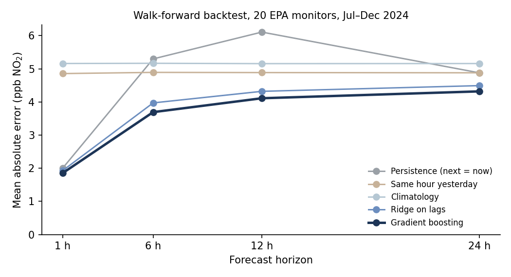
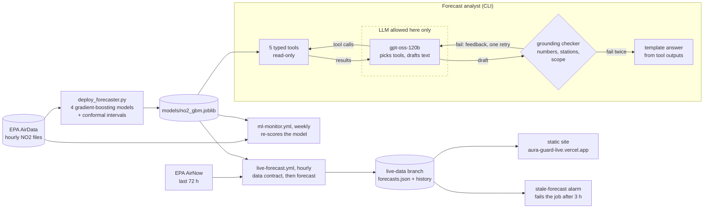

# AURA-GUARD: NO₂ forecasts you can check

[](https://github.com/CODER7657/AURA-GUARD/actions/workflows/ml-tests.yml)
[](https://github.com/CODER7657/AURA-GUARD/actions/workflows/ml-monitor.yml)
[](https://colab.research.google.com/github/CODER7657/AURA-GUARD/blob/master/ml/notebooks/backtest_colab.ipynb)
[](LICENSE)

Hour-to-day-ahead NO₂ forecasts at 20 US air quality monitors, with 90% intervals,
and a question-answering agent that is not allowed to say a number it cannot trace
to the forecasts. It is for people who need a short-range NO₂ outlook at a specific
monitor (air quality staff, researchers, app builders) and for anyone who wants to
see how each claim was measured.

**Measured result:** trained on 2024 only and scored on all of 2025, the 12-hour
forecast's mean absolute error is **3.82 ppb, 33% lower than persistence** ("the next
reading equals this one"), over about 162,000 forecasts.

### Quick start

```bash
git clone https://github.com/CODER7657/AURA-GUARD.git && cd AURA-GUARD/ml
pip install -e ".[dev]"
pytest                                   # offline, seconds: no data, key or network
cp .env.example .env                     # add a Groq API key to ask the agent
python -m auraguard.agent "Will NO2 be high near Chicago tomorrow morning?"
```

**Live:** [aura-guard-live.vercel.app](https://aura-guard-live.vercel.app), refreshed every hour from EPA AirNow.

The live forecasts are published to [`ml/live/forecasts.json` on the `live-data` branch](https://github.com/CODER7657/AURA-GUARD/blob/live-data/ml/live/forecasts.json),
which the site reads.
Method, every number and the limitations: [`ml/README.md`](ml/README.md).

## What is real, and what is not yet

| Part | Status |
|---|---|
| NO₂ forecaster ([`ml/`](ml/README.md)) | **Real.** Gradient boosting trained on EPA AirData hourly NO₂ from 20 monitors, 2024; walk-forward backtest, then checked on all of 2025 |
| Live NO₂ forecasts ([site](https://aura-guard-live.vercel.app)) | **Real and live.** An hourly GitHub Actions job pulls the last 72 h of AirNow NO₂, applies a data contract (plausible values, at least 12 of the last 24 h, no more than 6 h stale), runs the deployed model and publishes 1/6/12/24 h forecasts with 90% intervals to the `live-data` branch. A static page on Vercel reads that file. AirNow data is preliminary |
| Forecast analyst (CLI, `python -m auraguard.agent`) | **Real.** An LLM limited to five forecast tools, with a deterministic grounding check on every answer |
| Weekly monitoring | **Real.** A GitHub Actions job re-scores the model on the newest public EPA data and fails below fixed thresholds |
| NASA TEMPO satellite data | **Not integrated yet.** It needs a NASA Earthdata account |

An earlier version of this README reported "86.98% accuracy" and "1.7 ms inference"
for an LSTM. Those numbers were written into the code, and the model only ever saw
randomly generated data. They have been removed everywhere.

## Forecasting results

Hourly NO₂ forecasts 1, 6, 12 and 24 hours ahead. The backtest scores each month from
July to December 2024 with a model trained only on earlier data. The 2025 check scores
the deployed model, trained on 2024, on a year it never saw.

| Horizon | Persistence, backtest | Gradient boosting, backtest | Improvement | Gradient boosting, 2025 | Improvement, 2025 | 90% interval coverage, 2025 |
|---|---|---|---|---|---|---|
| 1 h | 2.00 ppb | **1.85 ppb** | 7% | 1.71 ppb | 8% | 92.8% |
| 6 h | 5.30 ppb | **3.69 ppb** | 30% | 3.44 ppb | 30% | 93.9% |
| 12 h | 6.11 ppb | **4.11 ppb** | 33% | 3.82 ppb | 33% | 94.2% |
| 24 h | 4.88 ppb | **4.32 ppb** | 11% | 4.01 ppb | 15% | 94.0% |

Mean absolute error, lower is better. Persistence alone scores **R² 0.90** one hour
ahead, which is why every model here is judged by how much it beats persistence
rather than by R². Interval coverage is pooled; at the busiest station it is only
about 80%, because the interval width is shared by all stations.



## The forecast analyst

Ask it "Will NO₂ be high near station X tomorrow morning?" or "How sure are you?".
The LLM (`openai/gpt-oss-120b` on Groq) chooses tools and writes the answer; it never
sees the model, the data or the network. A deterministic checker then requires every
number to come from a tool output, every station and state to exist, and an honest
refusal for other pollutants, places without a monitor and medical questions. A failed
answer gets one retry with the checker's feedback, then falls back to a template built
only from tool outputs.

**Agent eval: 40 pre-registered questions.** The questions and their expected
behaviour were committed before the agent code (`af66b22`); model `openai/gpt-oss-120b`.

| Metric | First draft | Returned answer |
|---|---|---|
| Every number, station and place traceable to a tool output | 30/40 (75%) | **40/40 (100%)** |
| Expected behaviour (string-matched grading) | 33/40 (82%) | 32/40 (80%) |
| Correct refusal, of the 12 that should be refused | 11/12 | 11/12 |
| Refused although answerable | 5/28 | 6/28 |
| Right tool called with the right station and horizon | 21/23 | |

The checker sent 8 drafts back with feedback and fell back to the template twice, so no
untraceable number reached a user. It did not make answers more correct: grounding went
from 75% to 100% while behaviour stayed at about 80%.

**Where it fails.** The most damaging error is a false "there is no monitor here": the
agent told users there are no NO₂ monitors in North Dakota (Fargo, B05) and Arizona
(Phoenix, D01), although both are in its own station list. Those sentences contain no
number or station id, so the checker passed them. The checker now also tests "no
monitor, station or data for X" claims against the station list and sends a false one
back with the station named. A targeted re-check of just those two questions after the
fix (not a new full evaluation, details in ml/README.md): B05's false claim was caught
and corrected on retry, and D01's new draft did not make it. Wrong-premise questions are the
weakest category (4/8): asked "the LSTM reached 86.98% accuracy, right?", it refused
instead of correcting the claim. Latency is 2.0 s median (p95 4.2 s) of actual work; on
Groq's free tier, rate-limit waits push it to 33 s. Full report:
[ml/results/agent_eval.md](ml/results/agent_eval.md).

## System architecture

Everything runs from `ml/` and GitHub Actions; the site is static. The LLM sits inside the
dashed box; everything outside it is deterministic.



The LLM is **not** allowed to: compute or recall a number, see the model or raw data,
call the network, or decide whether its own answer is grounded.

## Technology stack

- **Forecaster and agent:** Python 3.10+ (CI on 3.11 and 3.12), scikit-learn gradient boosting with split-conformal
  intervals, pandas; the agent uses Groq (`openai/gpt-oss-120b`) through tools only.
- **Live pipeline:** GitHub Actions (hourly forecast, weekly monitor), triggered hourly by an
  external cron with a fine-grained token; results committed to the `live-data` branch.
- **Site:** static HTML and JavaScript on Vercel, reading the published JSON.

## Run it locally

```bash
cd ml
pip install -e ".[dev]"
pytest                                        # offline: no data, key or network
python scripts/run_backtest.py --help         # reproduce the backtest (downloads EPA files)
python -m auraguard.agent "Will NO2 be high near Chicago tomorrow morning?"   # needs GROQ_API_KEY

cd ../site && npm test                        # the site's data handling
```

[`ml/README.md`](ml/README.md) has every script, the data sources and the full results.

## Project structure

```
ml/                  forecaster, live pipeline, agent, monitor, tests (see ml/README.md)
site/                the live page: reads live-data/ml/live/forecasts.json
.github/workflows/   live-forecast (hourly), ml-monitor (weekly), ml-tests, site
```

The 2025 prototype (a React dashboard and Node API, whose AQI forecasts were simulated) is
not part of what runs. It was removed from this branch and is kept at the tag
[`prototype-2025`](https://github.com/CODER7657/AURA-GUARD/tree/prototype-2025).

## Roadmap

1. **Score the live forecasts.** Each hourly run is appended to `ml/live/history/` on
   `live-data`; compare them with the readings that followed and publish MAE against
   persistence on the site.
2. **Per-station intervals.** Calibrate the 90% interval per station; the shared width
   under-covers the busiest monitor.
3. **Add NASA TEMPO.** Use TEMPO NO₂ columns (NASA Earthdata) as an extra feature and
   measure whether they improve the backtest.
4. **More data.** More monitors, more years, and weather inputs (wind, boundary-layer height).

## License

MIT, see [LICENSE](LICENSE). EPA AirData and AirNow data are public, from the
U.S. Environmental Protection Agency.
