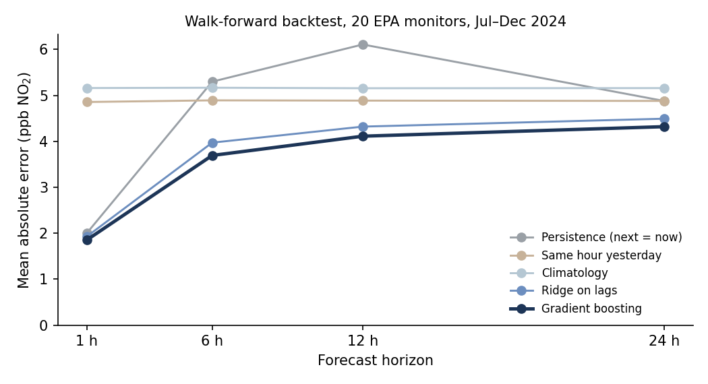

# NO₂ forecaster

Forecasts hourly NO₂ at US monitoring stations 1, 6, 12 and 24 hours ahead, and
measures how well it does with a walk-forward backtest on real data.

## Data

[EPA AirData](https://aqs.epa.gov/aqsweb/airdata/download_files.html) hourly NO₂ for
2024 (`hourly_42602_2024.zip`, 29 MB, public, no account needed). The 20 monitors
with the most valid hours are used, one instrument per site: the Los Angeles basin,
Chicago, St. Louis, Kansas City, Phoenix, New Jersey, North Dakota, Utah and rural
Kansas, averaging from 1.3 to 26 ppb (`results/backtest_summary.json` lists them).

## Method

A forecast is made at an origin hour *t* for the target hour *t + h*.

- **Features**, all from readings at or before *t*: the last 24 hourly values, the
  target hour one day and one week earlier, 6 h and 24 h rolling means, 24 h rolling
  spread, plus the target hour's local hour of day and weekday. Missing hours stay
  missing; nothing is filled in. A test checks that changing future readings changes
  no feature.
- **Models:** three baselines that any useful model has to beat (persistence, same
  hour yesterday, climatology by station, hour and weekday), ridge regression on the
  features, and histogram gradient boosting with the station as a categorical feature.
  One model per horizon.
- **Backtest:** for each month from July to December 2024, models are trained only on
  targets more than 14 days before that month, those last 14 days calibrate
  split-conformal 90% prediction intervals, and the month itself is the test set.
  Every number below is from test months the model never saw.

## Results

Pooled over all six test months (about 87,000 forecasts per horizon):

| Horizon | Model | MAE (ppb) | RMSE (ppb) | R² | vs persistence | 90% interval coverage |
|---|---|---|---|---|---|---|
| 1 h | Persistence | 2.00 | 3.43 | 0.904 | 0% | 88.8% |
| 1 h | Same hour yesterday | 4.85 | 7.77 | 0.506 | −143% | 88.2% |
| 1 h | Climatology | 5.16 | 8.01 | 0.475 | −158% | 87.2% |
| 1 h | Ridge on lags | 1.93 | 3.19 | 0.917 | +4% | 88.8% |
| 1 h | **Gradient boosting** | **1.85** | **3.13** | **0.920** | **+7%** | 88.4% |
| 6 h | Persistence | 5.30 | 8.28 | 0.439 | 0% | 88.1% |
| 6 h | Ridge on lags | 3.97 | 6.00 | 0.705 | +25% | 87.8% |
| 6 h | **Gradient boosting** | **3.69** | **5.81** | **0.724** | **+30%** | 87.6% |
| 12 h | Persistence | 6.11 | 9.16 | 0.312 | 0% | 88.5% |
| 12 h | Ridge on lags | 4.32 | 6.44 | 0.659 | +29% | 87.8% |
| 12 h | **Gradient boosting** | **4.11** | **6.41** | **0.663** | **+33%** | 87.5% |
| 24 h | Persistence | 4.88 | 7.79 | 0.504 | 0% | 88.2% |
| 24 h | Ridge on lags | 4.49 | 6.71 | 0.632 | +8% | 87.8% |
| 24 h | **Gradient boosting** | **4.32** | 6.74 | 0.628 | **+11%** | 87.6% |

All five models at every horizon are in [`results/summary.md`](results/summary.md).



**What the numbers say**

- **R² on its own is misleading here.** Persistence, which predicts that the next hour
  equals this hour, already scores R² 0.90 one hour ahead. Skill against persistence
  is the honest measure of what a model adds.
- **The models earn most at 6 to 12 hours,** where NO₂ follows the daily traffic cycle
  and "same as now" is the wrong phase of it. At 24 h the same hour yesterday is already
  a strong guess, and the gain shrinks to 11%.
- **Intervals are slightly narrow:** 87.5–88.4% of outcomes fall inside the nominal 90%
  interval, because the 14 days of calibration don't fully capture month-to-month change.
- **October to December are hardest for every model.** Gradient boosting's error grows
  50–90% from July to December depending on horizon, likely because colder months bring
  more variable NO₂.
- Gradient boosting predicts in about **0.05 ms** per forecast in batch on Colab.

## Reproduce

Runs on a free Colab CPU runtime in about 10 minutes:
[`notebooks/backtest_colab.ipynb`](https://colab.research.google.com/github/CODER7657/AURA-GUARD/blob/master/ml/notebooks/backtest_colab.ipynb).
It downloads the EPA file onto the Colab machine only.

```bash
python scripts/run_backtest.py --data hourly_42602_2024.zip --out results   # the backtest
python scripts/plot_results.py                                               # chart and table
python scripts/export_app_metrics.py                                         # file the backend serves
```

Tests use small synthetic series, need no download, and run in seconds:

```bash
pip install -e ".[dev]"
pytest
```

## Limitations

- **Not deployed.** The app still serves simulated forecasts. Deploying needs the
  trained model plus each station's last 7 days of readings at request time.
- **One year, 20 monitors.** Busy urban sites and quiet rural ones are mixed; results
  per station type are not reported separately.
- **No weather inputs.** Wind and boundary-layer height drive NO₂ and are the most
  likely source of further gains.
- **No satellite data yet.** NASA TEMPO NO₂ columns are the planned next feature.
